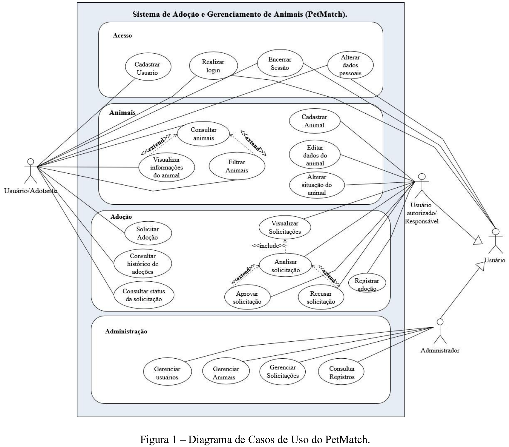
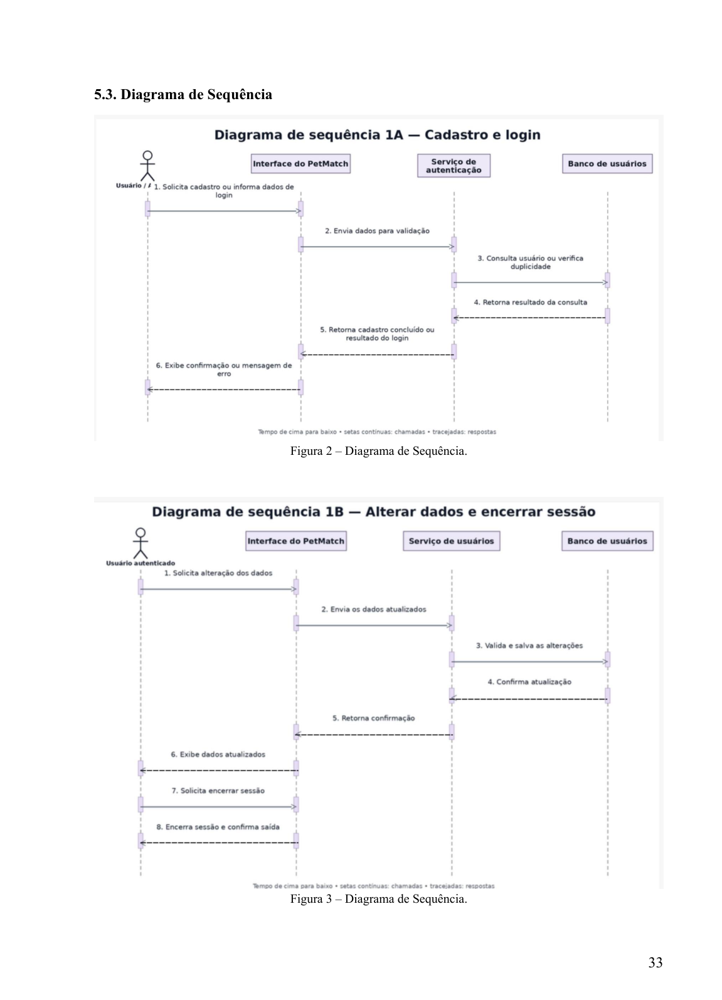
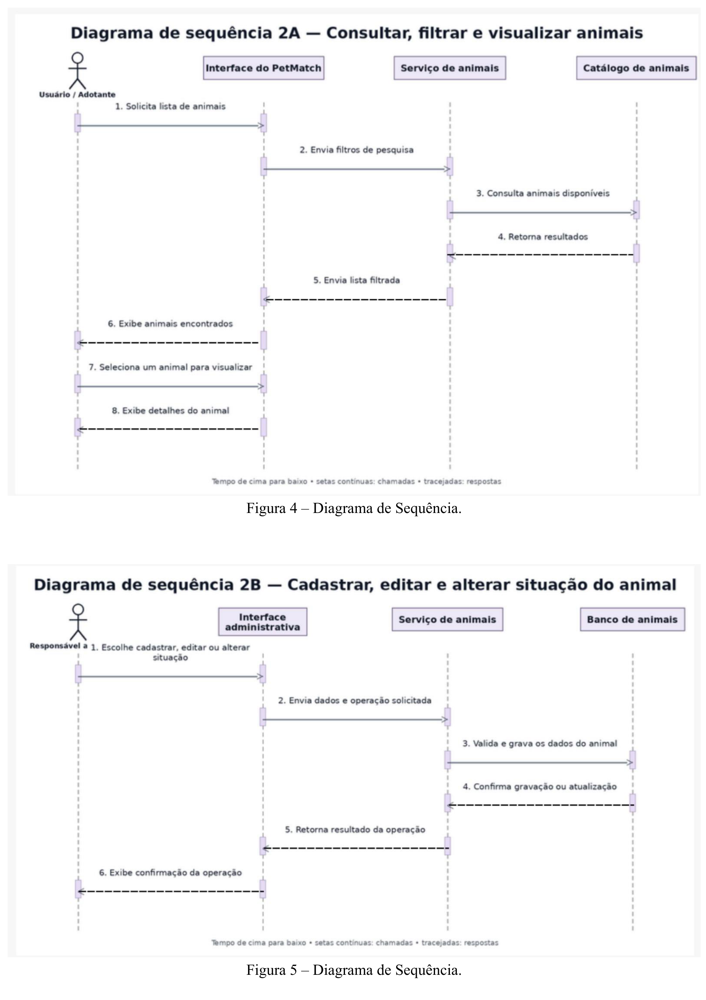
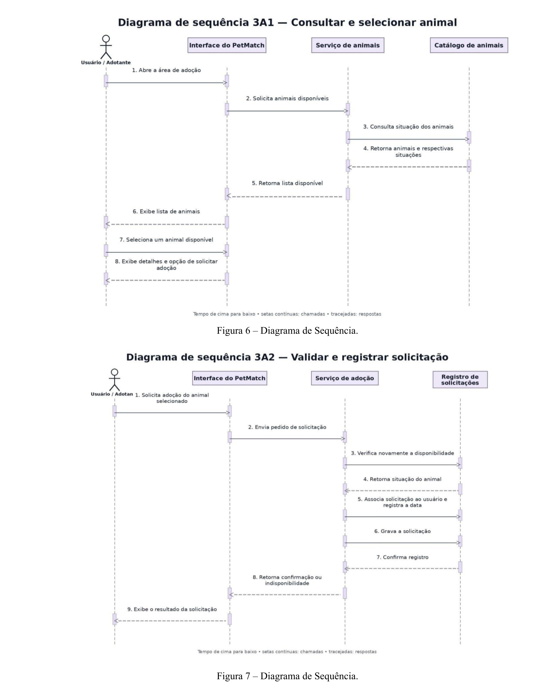
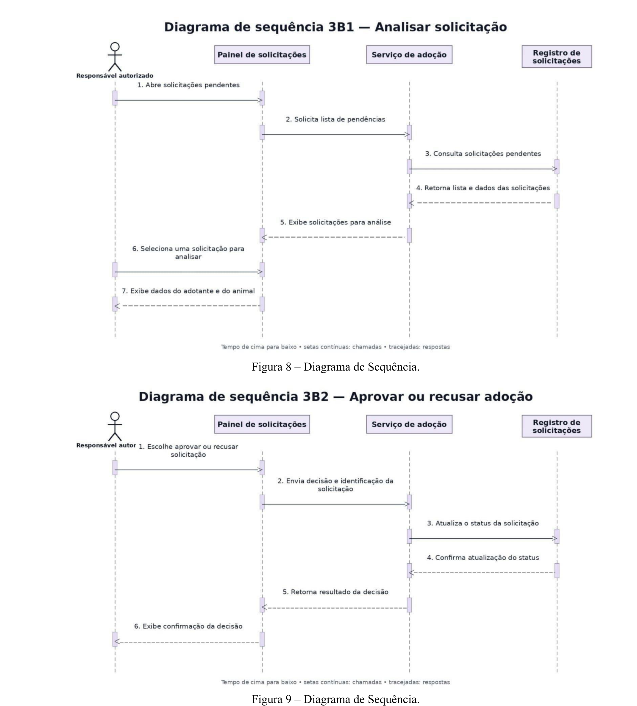
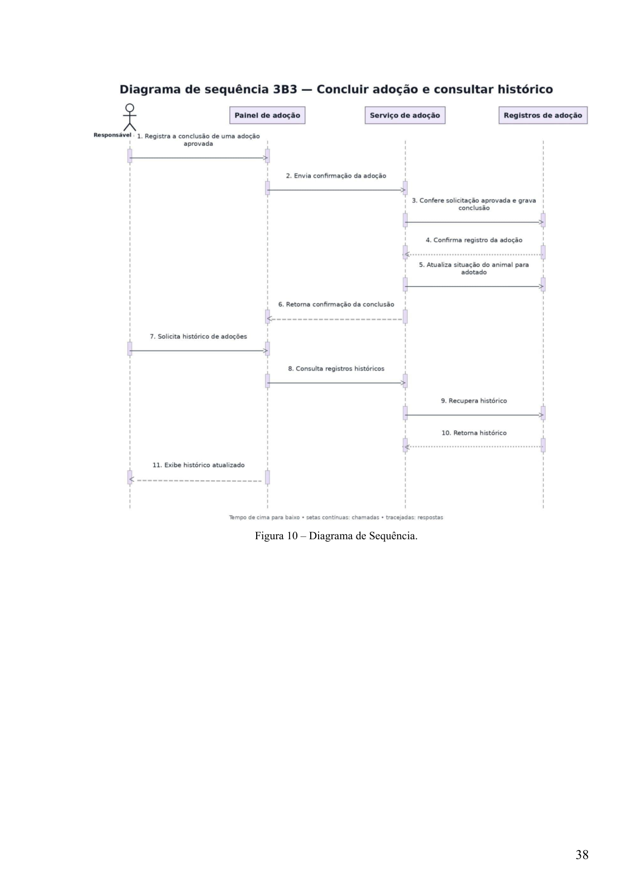
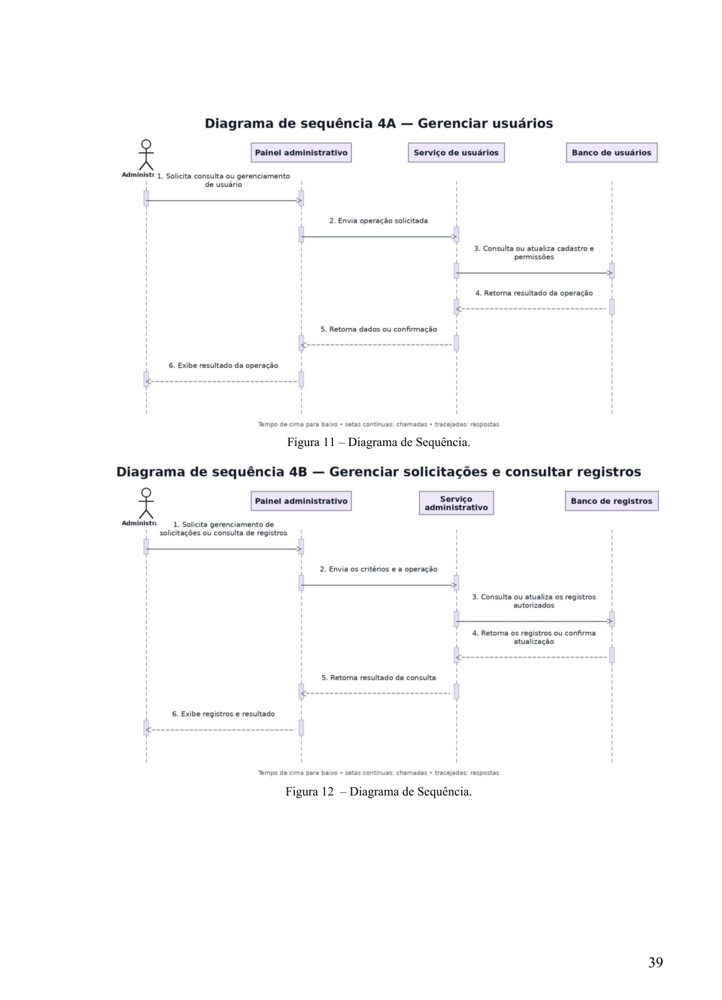
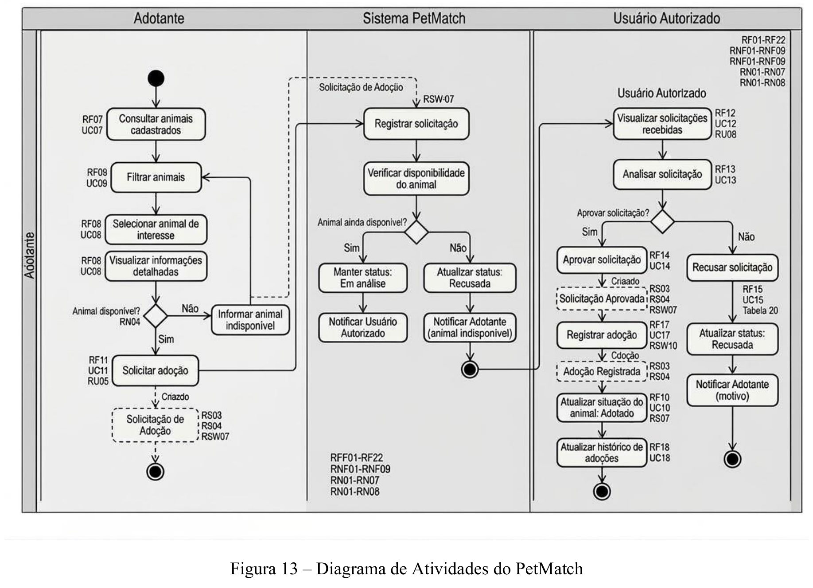

# PetMatch – Sistema de Adoção e Gerenciamento de Animais

## 1. Introdução

### 1.4. Descrição Geral do Software

O PetMatch é um sistema destinado ao gerenciamento de animais disponíveis para adoção e ao apoio ao processo de adoção responsável.

O sistema tem como objetivo centralizar as informações sobre usuários, animais, solicitações de adoção e registros de adoções, permitindo a realização de consultas, cadastros, atualizações e o acompanhamento das etapas do processo de adoção.

### 1.5. Descrição dos Usuários

O PetMatch possui diferentes tipos de usuários, cada um com responsabilidades e permissões específicas dentro do sistema. Eles são classificados da seguinte forma:

**1. Usuário/Adotante:** Pessoa que acessa o sistema para consultar os animais disponíveis para adoção e realizar solicitações de adoção.

**2. Responsável pelo gerenciamento:** Pessoa autorizada a cadastrar, editar e gerenciar as informações dos animais, além de acompanhar as solicitações de adoção.

**3. Administrador:** Usuário responsável pela administração do sistema, possuindo permissões para gerenciar usuários, animais, solicitações e registros.

## 2. Requisitos Gerais do Software

### 2.1. Requisitos Funcionais

Os requisitos funcionais descrevem as funcionalidades que o sistema PetMatch deverá oferecer aos seus usuários, estabelecendo as operações que poderão ser realizadas durante o gerenciamento de animais e o processo de adoção.

Os requisitos estão organizados em cinco grupos funcionais:

**Gerenciamento de Usuários**

| Código | Requisito | Descrição |
|---|---|---|
| RF01 | Cadastrar usuário | O sistema deve permitir que um novo usuário realize seu cadastro. |
| RF02 | Realizar login | O sistema deve permitir que o usuário entre no sistema utilizando suas credenciais. |
| RF03 | Encerrar sessão | O sistema deve permitir que o usuário encerre sua sessão. |
| RF04 | Alterar dados pessoais | O sistema deve permitir que o usuário altere seus dados cadastrais. |

**Gerenciamento de Animais**

| Código | Requisito | Descrição |
|---|---|---|
| RF05 | Cadastrar animal | O sistema deve permitir que um usuário autorizado cadastre um animal. |
| RF06 | Editar dados do animal | O sistema deve permitir que um usuário autorizado altere as informações de um animal cadastrado. |
| RF07 | Consultar animais | O sistema deve permitir que os usuários consultem os animais cadastrados. |
| RF08 | Visualizar informações do animal | O sistema deve apresentar informações detalhadas sobre o animal selecionado, incluindo nome, espécie, raça, idade, sexo, porte, características, localização, situação de adoção e fotografia. |
| RF09 | Filtrar animais | O sistema deve permitir que o usuário filtre animais de acordo com características como espécie, porte, idade, sexo, raça e disponibilidade. |
| RF10 | Alterar situação do animal | O sistema deve permitir que um usuário autorizado altere a situação de adoção do animal. |

**Processo de Adoção**

| Código | Requisito | Descrição |
|---|---|---|
| RF11 | Solicitar adoção | O sistema deve permitir que um usuário interessado solicite a adoção de um animal disponível. |
| RF12 | Visualizar solicitações | O sistema deve permitir que usuários autorizados visualizem as solicitações de adoção recebidas. |
| RF13 | Analisar solicitação | O sistema deve permitir que um usuário autorizado analise uma solicitação de adoção. |
| RF14 | Aprovar solicitação | O sistema deve permitir que um usuário autorizado aprove uma solicitação de adoção. |
| RF15 | Recusar solicitação | O sistema deve permitir que um usuário autorizado recuse uma solicitação de adoção. |
| RF16 | Consultar status da solicitação | O sistema deve permitir que o usuário acompanhe o status de sua solicitação. |
| RF17 | Registrar adoção | O sistema deve permitir registrar a conclusão de uma adoção. |
| RF18 | Consultar histórico de adoções | O sistema deve permitir consultar o histórico de adoções realizadas. |

**Administração**

| Código | Requisito | Descrição |
|---|---|---|
| RF19 | Gerenciar usuários | O sistema deve permitir ao administrador consultar e gerenciar os usuários cadastrados. |
| RF20 | Gerenciar animais | O sistema deve permitir ao administrador gerenciar os animais cadastrados. |
| RF21 | Gerenciar solicitações | O sistema deve permitir ao administrador acompanhar e gerenciar as solicitações de adoção. |
| RF22 | Consultar registros | O sistema deve permitir ao administrador consultar informações relacionadas aos cadastros e adoções realizadas.

### 2.2. Requisitos Não Funcionais

Os requisitos não funcionais estabelecem critérios de qualidade e condições que o sistema PetMatch deverá atender durante sua utilização. Eles estão relacionados à usabilidade, desempenho, segurança, disponibilidade e manutenção do software.

| Código | Requisito | Descrição |
|---|---|---|
| RNF01 | Usabilidade | A interface deve ser simples, intuitiva e organizada, permitindo o acesso às principais funcionalidades sem procedimentos desnecessariamente complexos. |
| RNF02 | Desempenho | O sistema deve responder às solicitações de consulta de animais, login e visualização de informações em até 3 segundos, em condições normais de uso. |
| RNF03 | Segurança | O sistema deve proteger os dados dos usuários contra acesso não autorizado. |
| RNF04 | Autenticação e autorização | As funcionalidades administrativas devem estar disponíveis somente para usuários autenticados e com as permissões correspondentes. |
| RNF05 | Integridade dos dados | O sistema deve preservar a consistência das informações armazenadas. |
| RNF06 | Disponibilidade | O sistema deve apresentar disponibilidade mínima de 99% ao mês, exceto durante períodos de manutenção programada. |
| RNF07 | Compatibilidade | O sistema deve ser compatível com os navegadores e ambientes definidos para sua utilização. |
| RNF08 | Manutenibilidade | A estrutura do sistema deve facilitar futuras correções, atualizações e extensões. |
| RNF09 | Privacidade | Os dados pessoais dos usuários devem ser tratados de forma adequada e protegidos contra acesso indevido. |

### 2.3. Regras de Negócio

As regras de negócio estabelecem as condições e restrições que devem ser respeitadas pelo sistema PetMatch, garantindo que os processos de gerenciamento de animais e adoção sejam realizados de maneira organizada e segura.

As regras são identificadas pelo prefixo RN, conforme descrito a seguir:

| Código | Regra de Negócio | Descrição |
|---|---|---|
| RN01 | Gerenciamento de animais | Apenas usuários autorizados podem cadastrar, editar e alterar a situação dos animais cadastrados. |
| RN02 | Adoção responsável | Uma solicitação de adoção somente poderá ser aprovada após ser analisada por um usuário autorizado. |
| RN03 | Cadastro de adotantes | Apenas usuários cadastrados e autenticados poderão solicitar a adoção de animais. |
| RN04 | Controle de disponibilidade | Os animais devem possuir uma situação de adoção: disponível, em processo de adoção ou adotado. Animais indisponíveis não poderão receber novas solicitações. |
| RN05 | Divulgação dos animais | Os animais divulgados devem apresentar informações como nome, espécie, raça, idade, sexo, porte, características, localização, situação de adoção e fotografia. |
| RN06 | Acompanhamento das adoções | Cada solicitação deve possuir um status atualizado, e o adotante poderá consultar somente as solicitações vinculadas à sua conta. |
| RN07 | Centralização das informações | Toda adoção concluída deve estar vinculada a uma solicitação aprovada e permanecer registrada no histórico de adoções. |
| RN08 | Controle de acesso | As funcionalidades do sistema devem ser acessadas conforme as permissões de cada perfil: adotante, responsável e administrador. |

## 3. Diagramas UML

### 3.1. Diagramas de Casos de Uso

**Figura 1 – Diagrama de Casos de Uso do PetMatch.**

### 3.2. Diagramas de Sequência
Os diagramas de sequência representam as interações entre os atores e os componentes do sistema PetMatch durante a execução de suas funcionalidades. Ao todo, são apresentados 11 diagramas, organizados conforme os casos de uso do sistema.

**Figuras 2 e 3 – Cadastro, login, alteração de dados e encerramento de sessão.**

**Figuras 4 e 5 – Consulta de animais e gerenciamento de animais.**

**Figuras 6 e 7 – Consulta e seleção de animal, validação e registro de solicitação.**

**Figuras 8 e 9 – Análise e aprovação ou recusa de adoção.**

**Figura 10 – Conclusão da adoção e consulta do histórico.**

**Figuras 11 e 12 – Gerenciamento de usuários e solicitações.**

### 3.3. Diagramas de Atividades
O diagrama de atividades apresenta o fluxo de funcionamento do sistema PetMatch, desde a consulta e seleção de animais pelo adotante até a análise da solicitação, aprovação ou recusa da adoção e atualização dos registros pelo usuário autorizado.

**Figura 13 – Diagrama de Atividades do PetMatch.**

## Integrantes da Equipe

-Ana Vitória Farias
-Jucilla Kétura
-Paolla Gabriele
